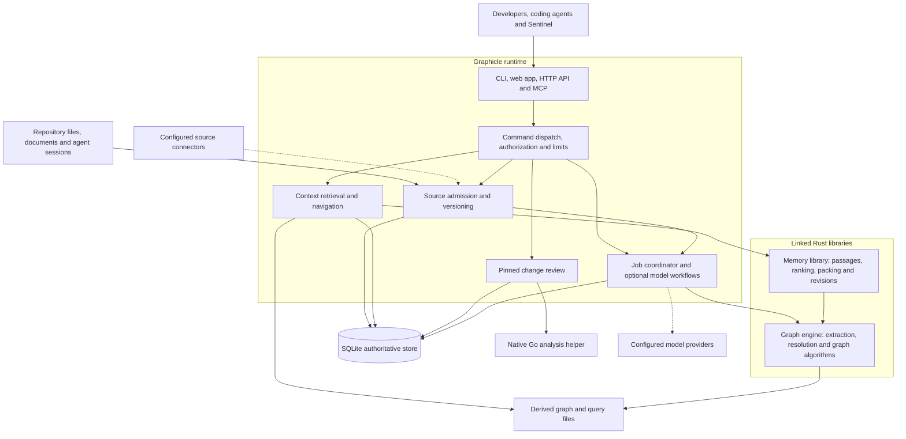
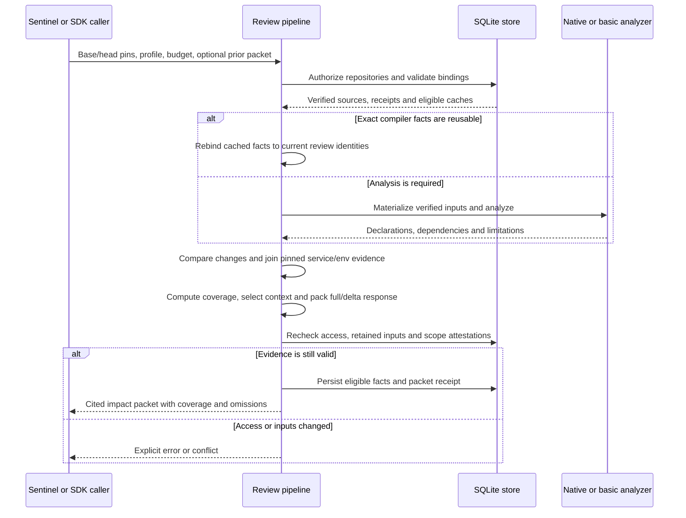
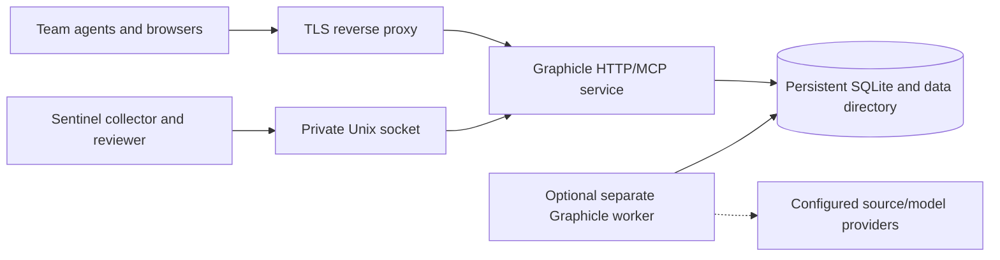

# Graphicle high level design

**Status:** Current implementation as of 10 November 2026.

**Baseline:** Graphicle 0.2.0, `context-improvement-plan` at `88e315b9065841219ef4c538158733ae6dad4c72`. The changelog marks this version as unreleased; deployed builds can lag this branch.

Graphicle is a local-first code graph and project-memory system. It turns admitted repository files, documents and agent sessions into cited context for developers and coding agents. Its review path compares immutable source snapshots and supplies evidence about changed code and its dependencies. Optional model workflows use that evidence to answer questions, propose memories, generate documentation or assist code changes.

This design describes the implemented component boundaries, storage model, request flows and deployment choices. The companion [feature and performance update](graphicle-update-2026-11-10.md) contains the feature inventory, benchmark results and Sentinel deployment observations.

## Design goals and scope

- Provide code, documents and reviewed memory through a common CLI, browser app, HTTP API and MCP interface.
- Preserve the exact source identity behind every cited excerpt and report incomplete analysis or omitted context.
- Reuse unchanged source, analysis and graph data while checking authorization and freshness.
- Support a single-machine installation and a persistent team/review service without requiring an external database.
- Keep model calls optional for ordinary retrieval and static analysis; bound model workflows by configured call, token and cost budgets.

Compiler-backed pinned impact is primarily Go-based. Terraform, Helm, Bash, Python, Rust, TypeScript and JavaScript have basic impact scopes with explicit semantic limitations. Cross-service paths require pinned configuration evidence; they describe potential static dependencies. Runtime discovery, complete program behavior and automatic approval of a change are outside this contract.

## System architecture

The default system is a modular Rust application. Each box inside the runtime below represents a responsibility within that application. Workers and native analysis helpers may run in separate processes.

### Component ownership

| Component | Responsibility | Main implementation |
| --- | --- | --- |
| Runtime | Transports, permissions, source storage, application commands, jobs, connectors and deployment | [`crates/graphicle`](../crates/graphicle/README.md), Cargo package `graphicle-runtime` |
| Memory library | Passage ingestion, lexical ranking/fusion, evidence packing, temporal revisions and shared graph operations; storage and authorization remain with its caller | [`graphicle-memory`](../crates/graphicle-memory/README.md) |
| Graph engine | Parsing, symbol/call/import extraction, resolution, incremental graph building, graph algorithms and exports | [`graphicle-graph`](../crates/graphicle-graph/README.md); its Rust library package is named `graphicle` |
| Review pipeline | Snapshot validation, compiler/basic impact, service/environment relationships, context selection, coverage, deltas and reuse proofs | [`review.rs`](../crates/graphicle/src/review.rs) and its review modules |
| Storage and access | Transaction boundaries, credentials, repository scopes, immutable objects/manifests and compatibility checks | [`store.rs`](../crates/graphicle/src/store.rs), [`permissions.rs`](../crates/graphicle/src/permissions.rs) |
| Client integrations | Typed HTTP clients, local-server lifecycle and validation/materialization of review or secondary-context packets | [Python SDK](../sdk/python/README.md), [TypeScript SDK](../sdk/typescript/README.md), [MCP](mcp.md) |

The memory library performs no network or model calls. The runtime owns external access and model invocation. Core exposes capabilities through `build.info`; unavailable edition-specific operations are rejected explicitly. Optional extensions register their own operations and job kinds through the existing extension registry.

## Storage and identity

The authoritative runtime database is **`reviews.sqlite3`** in the selected data directory. SQLite uses write-ahead logging, short immediate write transactions, and read-only snapshot transactions. Parsing and native review analysis happen outside long write transactions; jobs do not hold SQLite transactions across network calls. Derived graph/query files and process caches accelerate reads alongside the database.

| Entity | Meaning and ownership |
| --- | --- |
| Workspace and credential | Tenant/access boundary. Credentials have roles, optional expiry and repository scope; access tokens are stored as hashes. |
| Repository/project | An authorized source collection with a current source manifest and generation. |
| Source object | Exact text or binary bytes, keyed by repository and SHA-256. Identical content is reused within the repository; cross-project reuse requires authorized donor snapshots. |
| Source snapshot | Immutable manifest mapping paths to content identities. The current head can advance while retained snapshots remain addressable. |
| Review pin | Repository, snapshot, Git commit and admission-policy identity. Commit association and source completeness are collector attestations; Graphicle verifies admitted bytes and the stored binding. |
| Graph episode | A graph derived from a particular source head set and engine format. Recorded nodes/edges retain history and source provenance. A snapshot and an episode are different identities. |
| Passages and query files | Derived retrieval data keyed to source revisions and compatible formats/builds. Passage indexes support text ranking; saved query files support selective graph reads. |
| Memory and claim revisions | Source-backed proposals, approval state, history and links to evidence/code revisions. Normal recall uses eligible reviewed memory. |
| Review facts and receipts | Cached compiler facts, package exports, packet identities and reuse metadata. Receipts do not store excerpt bodies or prove that a reviewer completed a review. |
| Jobs and usage | Durable job state, leases, attempts, model-call records, budget reservations and usage. |

The schema is in [`schema.sql`](../crates/graphicle/src/schema.sql) and the accompanying workflow/temporal schemas. Graph projection is managed by [`graph_projection.rs`](../crates/graphicle/src/graph_projection.rs).

Three invariants connect these entities:

1. **A digest is an identity, not authorization.** Every source lookup and reuse path remains scoped to an authorized repository.
2. **A graph is derived evidence.** A newer source head can exist before its graph is ready. Context reports episode lag and excludes changed source from older graph citations.
3. **Source equality is narrower than review equivalence.** Equal excerpt bytes do not preserve an old commit binding, prove complete analysis or establish that a review happened.

## Main data flows

### Source admission and graph projection

1. A local sync, connector or trusted review collector supplies source content and metadata. Path exclusions, content handling and admission limits apply before sources become available.
2. Repository admission uses `sync.prepare`, paginated `sync.missing`, `sync.upload` and `sync.commit`. The client uploads missing objects or requests reuse from explicitly authorized donor snapshots. Binary inputs preserve their exact bytes and are excluded from text retrieval.
3. Commit parses and chunks changed text in bounded batches, reusing current-revision parse/chunk records for unchanged path/hash pairs.
4. The final transaction checks `expected_snapshot`. A competing successful sync causes a conflict instead of overwriting its head. Commit publishes the manifest/head, records bindings, invalidates affected derived state and queues graph projection.
5. Projection builds or updates a graph episode, records its source manifest and prepares graph/query data. The local `sync` command normally completes graph work before returning; background/no-graph modes and API admission allow asynchronous projection.

Retrieval itself does not rebuild the graph. While projection is pending, source retrieval can use the admitted files and graph-assisted retrieval uses checked evidence from the previous episode. `serve --no-worker` still admits sources and queues jobs, so a separate worker or explicit projection operation is needed to execute that queued work.

Source connectors include GitHub, Slack, Notion, Google Drive, Jira and Confluence, with provider-specific coverage and sharing rules. Documents and sessions enter the same source/evidence model, although original binaries and extracted text keep separate hashes. See [source ingestion](../crates/graphicle/README.md#bring-your-sources) and the [admission protocol](pilot-protocol.md).

### Context retrieval and navigation

1. Resolve the project/workspace and filter sources and memories by the caller's access, requested scope and freshness.
2. Choose the indexed retrieval path when the query and available index support it. Other options or missing index coverage select the bounded full path.
3. Gather applicable lexical BM25, speaker, identifier and code-graph candidates. Optional configured embeddings or local rerankers add semantic scoring. Graph and memory expansion retain their own traversal limits.
4. Fuse/rank candidates and pack cited excerpts within the requested budget. The response carries source identities, coordinates, coverage, freshness and omissions.
5. For a workspace query, search authorized projects and combine their evidence within one budget, adding supported cross-repository relationships. Every excerpt retains its repository identity.

Saved query files avoid loading entire graphs for common navigation/context operations. Indexed lexical retrieval can cover the retained file index even when a property-graph walk reaches its own limit. A bounded response still selects only part of the available evidence; zero corpus omissions does not mean every relevant passage fits in the answer.

Ordinary `context` and MCP recall are model-free by default. Local ONNX embedding/reranking requires the optional build feature and configured assets. Model-assisted answering is a separate workflow. See [`indexed_query.rs`](../crates/graphicle/src/indexed_query.rs), [`passage_index.rs`](../crates/graphicle/src/passage_index.rs), [`query_file.rs`](../crates/graphicle/src/query_file.rs) and [local inference](../crates/graphicle/LOCAL_INFERENCE.md).

### Pinned change review

The review path operates on admitted immutable source sets. It does not require a newly projected ordinary code graph for each review.

Go analysis materializes an isolated source tree, uses the supplied build profile and dependencies, and retains unresolved facts conservatively. Persistent serving reuses the compiled helper; persisted caches can reuse compiler/package facts across requests. Basic language analysis, supplied execution observations and optional history enrich the same review packet without acquiring stronger authority than their evidence supports.

Pinned service manifests connect HTTP, gRPC and event boundaries. Literal deployment environment values can narrow selection when reader bindings and configuration scope are unambiguous. Ordered paths are potential static flows, not runtime traces.

The output separates three questions:

- **What could be affected?** Risk schema v2 describes the full analysis before response packing.
- **How complete was the analysis and delivered evidence?** Global coverage, scoped changed-Go analysis coverage and packet omissions have distinct meanings.
- **Can previous review work be reused?** Input-equivalence proofs require complete component evidence and unchanged review inputs/contracts. The caller must separately attest review completion.

On later pushes, SDKs validate and materialize packet deltas and optional identical-text references. An inaccessible, evicted or incompatible receipt requires a full packet. Secondary-context helpers validate the exact expected head and preserve the primary review context on failure. See [pinned reviews](pinned-review.md), [service boundaries](service-boundaries.md), [business history](business-context.md) and [secondary context](secondary-context-and-semantic-previews.md).

### Memory and model workflows

Source ingestion or an explicit agent/model workflow can propose claims, decisions or procedures. The runtime validates their schema, citations and source scope; normal recall waits for approval. Revisions retain historical knowledge and event times, and source/code changes affect eligibility and freshness.

`basic` answering, bounded `reflect`, extraction, wiki generation and code-assistance workflows use configured models through runtime-owned budget and usage controls. A successful model call or valid quotation does not prove semantic correctness. The job coordinator records durable state, leases work, checks authorization and bounds retries. Jobs generally serialize per repository, with limited explicit exceptions for independent observer sources; synchronous review concurrency is a separate concern.

## Deployment architecture

Graphicle supports three primary arrangements:

| Arrangement | Runtime and storage | Suitable use |
| --- | --- | --- |
| Local developer installation | CLI/stdio MCP and optional browser server on the user's machine; local data directory | Interactive navigation, memory and context for coding agents |
| Shared team server | Persistent HTTP/MCP service behind a TLS reverse proxy; persistent data directory; per-user/agent keys | Authorized shared repositories, sources and memory |
| Sentinel review service | Persistent `serve --no-worker`, retained source/compiler caches, private Unix socket or controlled HTTP endpoint; explicit worker lifecycle | Repeated pinned reviews and head-context retrieval |

HTTP and Unix socket listeners are alternative server configurations; the diagram shows the integration choices, not simultaneous listeners on one process. A Unix socket must live in an owned private directory and is created with mode 0600. Shared HTTPS deployments keep the application on loopback behind the proxy. [Docker/systemd recipes](../deploy/README.md) and the [team guide](team.md) cover deployment.

Optional Neo4j and Qdrant adapters provide external graph/vector projections; **SQLite remains authoritative**. Optional Redis inference dispatch runs remote consumers while the coordinator keeps authorization and commit ownership. The `shared-context` CLI transfers immutable, expiring source/graph artifacts through GCS for another worker to query; it does not export the live SQLite store, sessions or reviewed memories. None of these adapters is required for the default system. Their availability is not evidence that they are configured in the observed Sentinel deployment.

## Security and failure handling

| Boundary or failure | Design behavior |
| --- | --- |
| Workspace and repository access | Validate capability, role, expiry/revocation and repository scope. Recheck access and retained sources before committing a long-running review result. |
| Untrusted source and model output | Treat source text as data; validate structure and exact citation locations. Proposals require review and keep attribution/uncertainty. |
| Concurrent source updates | Use expected-snapshot checks and immutable manifests; stale commits fail with conflict. Secondary retrieval rejects a mismatched head. |
| Missing or ambiguous analysis | Retain unresolved relationships and explicit coverage limitations. Incomplete analysis never certifies no impact. |
| Token or traversal limits | Report omitted/truncated evidence. Response packing does not change the v2 full-analysis verdict or silently retain a reuse proof after its required evidence is omitted. |
| Review timeout | Unix requests can set a cooperative execution deadline. Native subprocess cleanup precedes the structured timeout response; a client disconnect alone does not establish cancellation. |
| Unavailable worker | Jobs remain queued. `--no-worker` disables built-in background execution, not admission, authorization or explicit API operations. |
| Permission loss or source deletion | Invalidate affected local derivatives and queue scoped cleanup for configured external projections. |
| Store/version mismatch | Check reader compatibility before migrations; a program too old for the store is refused. Backups and deployment-specific restore/rollback validation protect upgrades. |

Local storage uses private filesystem permissions. Saved provider/model credentials are encrypted in the workspace vault using a private device-key file; this is not an OS Keychain or cloud KMS integration. Core does not provide enterprise identity-provider sign-in or provider-permission synchronization. Connector copies require an explicitly authorized audience, and existing provider permission restrictions remain enforced.

## Scale and operational tradeoffs

- **One authoritative store simplifies installation and consistency.** SQLite WAL permits snapshot reads alongside writes, but write serialization, host memory and disk remain capacity constraints. The supplied deployment does not establish an active-active multi-host database design.
- **Precompute reusable evidence.** Source hashing, incremental parses, passage postings, saved query files and package caches reduce repeated work. Cache identities include relevant source/configuration/analyzer inputs, and conservative invalidation can still make small edits expensive.
- **Keep query work bounded.** Default ordinary project admission is 100,000 files and 1 GiB, with 8 MiB indexing and 4 MiB structural-analysis per-file limits. Pinned review has its own admission limits. Workspace context searches eight projects by default and permits up to 32; these are bounds, not performance guarantees.
- **Separate review serving from background jobs.** A persistent helper improves repeated-review latency, while worker isolation reduces interference. Local concurrency tests support starting with one review at a time; additional concurrency needs workload-specific memory/latency validation.
- **Measure the whole path.** Record admission, projection, analysis, packing, cache hits/refusals, omissions, timeouts and peak memory separately. Sentinel's end-to-end stage timings include work absent from isolated component benchmarks.

The retained million-file synthetic tests establish bounded graph and retrieval behavior. Later paired optimizations preserve compared packets and reduce query costs, but general production latency, real-query relevance and combined large-source/large-memory behavior remain unqualified. The [performance update](graphicle-update-2026-11-10.md#performance-testing-results) preserves hardware, sample counts, baselines and memory tradeoffs.

## Open design and qualification work

1. Resolve the recorded disagreement between restored-source memory eligibility and stale-marker diagnostics, and qualify old-note recall beyond the newest 20,000 eligible memories.
2. Validate the current deployment candidate with full regression/quality checks and representative source, memory, concurrency and recovery workloads.
3. Agree deployment-specific latency, memory, freshness and retention targets; validate backup restoration and rollback against the exact build and workload.
4. Measure review relevance, task outcomes and model costs independently of successful delivery or static graph coverage.

These are the outstanding acceptance areas in the [large-repository readiness assessment](large-repository-readiness.md#pending-work-for-full-production). The latest recorded Sentinel observation and proposed follow-up period are linked from the [update document](graphicle-update-2026-11-10.md#sentinel-deployment-status).
